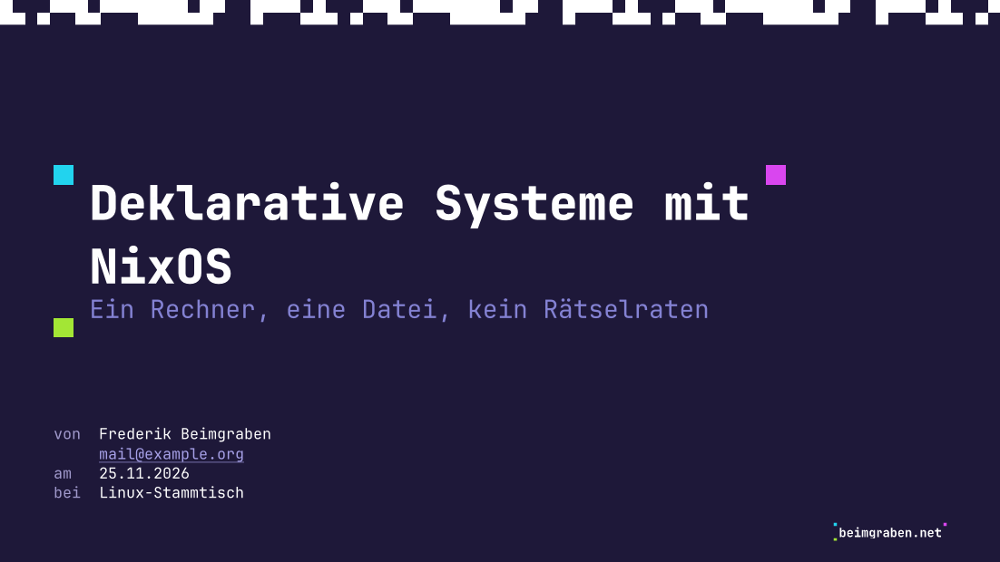

# bgslides

[](https://github.com/frederikbeimgraben/typst-beamer-template/actions/workflows/continuous-release.yml)

Typst presentation template in the style of
[beimgraben.net](https://beimgraben.net). It uses the colors, the font, the
logo and the pixel skyline of the website. The structure and the commands
follow the slides of
[hsrtreport-typst](https://github.com/frederikbeimgraben/hsrtreport-typst).



## Install

Run the two commands one time:

```sh
nix run github:frederikbeimgraben/typst-beamer-template#install         # the template
nix run github:frederikbeimgraben/typst-beamer-template#install-fonts   # JetBrains Mono
```

The first command makes `@local/bgslides:1.0.0` available to Typst. The second
command copies the fonts into `~/.local/share/fonts`, because Typst does not
load fonts from a package. After this, `typst compile slides.typ` needs no
flag.

Without Nix, clone the repository and do the same by hand:

```sh
ln -s "$PWD" ~/.local/share/typst/packages/local/bgslides/1.0.0
cp src/assets/fonts/*/*.ttf ~/.local/share/fonts/ && fc-cache -f
```

Inside a clone, `nix run .#build` compiles the example to `build/slides.pdf`
and `nix run .#watch` compiles it on every change.

## Use the template

```typ
#import "@local/bgslides:1.0.0": *

#show: bgslides.with(
  title: [Titel des Vortrags],
  subtitle: [Untertitel],
  author: "Frederik Beimgraben",
  date: datetime.today(),
  event: "Linux-Stammtisch",
  theme: "blue",        // "blue", "bordeaux" or "violet"
  appearance: "dark",   // "dark" or "light"
)

#outline-slide()

= Abschnitt

== Folientitel

- Punkt
  - Unterpunkt
```

A level 1 heading makes a section slide. A level 2 heading starts a new slide
and becomes its title. To start from the example instead, run:

```sh
typst init @local/bgslides:1.0.0 my-talk
```

## Look

| Website | Slides |
| --- | --- |
| Color variants blue, bordeaux, violet | `theme` |
| Light and dark appearance (dark is the default) | `appearance` |
| JetBrains Mono for all text | the only font of the slides |
| Pixel skyline at the top of the page | top edge of every slide |
| Logo with the cyan, lime and magenta pixels | footer, title slide |
| The three pixels around the name on the preview card | title slide, focus slide, list markers |
| Line below the logo on hover | line below every title |

The colors are the CSS custom properties of the website, see
`src/config/colors.typ`. `palette(theme:, appearance:)` returns them as a
dictionary, and `brand` holds the logo colors.

## Options

| Option | Default | Function |
| --- | --- | --- |
| `title`, `subtitle` | — | Title slide and PDF metadata |
| `short-title` | `auto` | Title in the footer |
| `author`, `email`, `date`, `event`, `institution` | `none` | Rows of the title slide |
| `labels` | `von`, `am`, `bei`, `für` | Labels of these rows |
| `extra-data` | `()` | More rows, as `(label, value)` pairs |
| `show-title-slide` | `true` | Print the title slide |
| `theme` | `"blue"` | Color variant of the website |
| `appearance` | `"dark"` | `"dark"` or `"light"` |
| `show-logo` | `true` | Logo in the footer |
| `aspect-ratio` | `"16-9"` | `"16-9"` or `"4-3"` |
| `font-size`, `lang` | 16pt, de | Text |

## Commands

| Command | Function |
| --- | --- |
| `#slide(title: [...], steps: n)[...]` | A slide with `n` steps |
| `#only("2-")[...]` | Content on some steps, without space on the others |
| `#uncover(2)[...]` | Content on some steps, the space stays |
| `#outline-slide(depth: 1)` | List of the sections, `depth: 2` adds the slides |
| `#focus-slide[...]` | One statement on a colored slide |
| `#cols(widths: auto)[...][...]` | Content in columns |
| `#info-box`, `#success-box`, `#warning-box`, `#important-box` | Boxes, each with an optional `title:` |
| `#custom-box(title: [...], color: ...)[...]` | Box in any color or palette role |
| `#alert[...]` | Text in the accent color |
| `#shell[...]` | A line with a `$` prompt |
| `#logo(color:, height:)` | The logo of the website |
| `#pixel-frame[...]` | The three logo pixels around content |
| `#skyline(width, color:)` | The pixel skyline |

Code blocks get line numbers and a syntax theme in the colors of the
palette. Tables get a header row in the accent color.

## License

| Files | License |
| --- | --- |
| `src/*.typ`, `src/**/*.typ` | CC BY-SA 4.0, see [LICENSE](LICENSE) |
| `example/` | MIT-0, see [LICENSE-MIT-0](LICENSE-MIT-0) |
| `src/assets/fonts/JetBrainsMono/` | SIL Open Font License 1.1, see [OFL.txt](src/assets/fonts/JetBrainsMono/OFL.txt) |
| `src/assets/logo/` | The logo of beimgraben.net, not covered by the licenses above |
